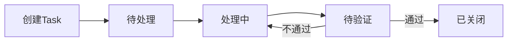
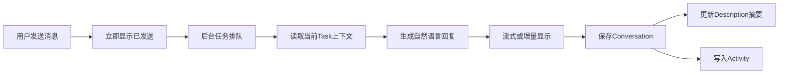
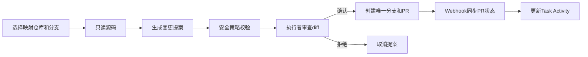

# Task Agent 产品需求文档

| 项目 | 内容 |
|---|---|
| 文档状态 | Draft，等待产品审阅 |
| 产品基础 | OpenProject Community Edition |
| 产品形态 | 基于当前分支开发和部署的独立精简版任务管理产品 |
| 核心对象 | Project、Task、Agent Conversation |
| 首期目标 | 删除认知负担，让用户进入系统后立即创建、处理任务并与 Agent 对话 |

## 1. 背景

OpenProject 提供了完整的项目管理能力，但当前团队主要使用任务提出、任务处理和 Agent 辅助解决问题。Gantt、成本、会议、Wiki、Backlogs、工时、资源管理等功能增加了菜单层级、页面复杂度和学习成本，也让最常用的任务操作被大量低频功能包围。

本产品以 OpenProject 为技术基础，保留成熟的用户、权限、项目、任务、附件、Activity 和审计能力，直接删除不需要的产品功能和运行入口，形成只围绕 Task 与 Agent 的独立产品分支。该分支后续直接用于部署和测试，不提供完整版与精简版之间的运行时切换。

## 2. 产品目标

### 2.1 核心目标

1. 用户登录后能在一个页面看到与自己有关的全部未完成任务。
2. 创建 Task 的必填项不超过 Project、标题和描述。
3. Task 详情聚焦任务内容、状态、负责人、附件、Activity 和 Agent。
4. Agent 对话具有类似 ChatGPT 网页版的连续对话体验，发送、等待、失败和完成状态明确。
5. Agent 的有效回复同步沉淀到 Task Description 和 Activity。
6. 普通用户不接触 Work Package、父子任务、Relation、模块配置或 Enterprise upsell。
7. 新产品的数据模型是原 OpenProject 数据结构的严格子集，支持从原系统无损导入所需数据。

### 2.2 成功指标

- 新用户首次创建 Task 的中位时间小于 2 分钟。
- 从 Home 打开 Task 的 P95 响应时间小于 1 秒，不包含首次开发环境编译。
- Agent 消息提交后 300ms 内展示“已发送/处理中”。
- Agent 最终回复、Task Description 和 Activity 同步成功率不低于 99%。
- 从原 OpenProject 导入 Project、Task、用户、附件和 Activity 时无数据丢失。

## 3. 非目标

首期不实现：

- Gantt、Calendar、Roadmap 和复杂排期。
- 父任务、子任务和任务依赖。
- Scrum、Backlog、Sprint 和 Story Point。
- 成本、预算、工时统计和资源规划。
- Wiki、News、Forum、Meeting 和 Documents。
- Portfolio、Program、BIM、Helpdesk。
- GitHub、GitLab、OpenProject Repository 和外部 Storage UI。
- 自定义 Dashboard、复杂 Grid 和跨项目组合报表。
- 新建一套独立 LLM 配置中心。
- 在首期直接删除共享底层表。无用模块代码、路由、菜单和构建入口会从本分支移除；仅为导入兼容暂时保留的历史表不提供运行入口，并在数据迁移稳定后另行评估清理。

## 4. 用户角色

### 4.1 Task 创建者

- 创建和编辑自己创建的 Task。
- 上传截图、日志和附件。
- 查看 Agent 对话及 Task Activity。
- 补充信息并对处理结果进行验证。
- 验证通过后关闭 Task，验证失败后退回处理中。

### 4.2 Task 执行者

- 查看直接分配给自己的 Task。
- 更新状态、负责人和处理说明。
- 与 Agent 对话，要求分析、定位、总结或提出解决方案。
- 在启用代码能力时选择 Project 映射的 Gitea 仓库和分支。
- 审核 Agent 生成的代码 diff，确认后创建 Pull Request。

### 4.3 管理员

- 管理用户、角色、Project、Task 类型、状态和工作流。
- 管理当前产品保留的功能配置。
- 配置 Agent 服务账号和 LLM。
- 配置 Gitea 连接及 Project 仓库映射。
- 查看配置诊断、迁移校验和审计信息。

管理员可以同时承担创建者或执行者角色。首期不把 PE、R&D 名称硬编码到业务逻辑，通过角色与权限模板表达。

## 5. 产品信息架构

### 5.1 一级导航

普通用户仅显示：

1. Home
2. Projects
3. Tasks

个人菜单保留账户设置、通知和退出。Agent 不作为全局一级菜单，只存在于 Task 详情。

管理员额外保留必要的 Administration 入口。

### 5.2 对象层级

```text
Project
└── Task
    ├── Overview
    ├── Activity
    ├── Files
    └── Agent
```

用户界面、URL 标题、按钮和帮助文案统一使用 Task/任务，不显示 Work Package/工作包。后端继续使用 OpenProject 的 `WorkPackage` 模型和表，以保证兼容。

## 6. 核心用户流程

### 6.1 创建和处理



状态通过管理员配置的状态 ID 映射，不依赖中文或英文名称。

### 6.2 Agent 对话



### 6.3 Agent 代码修复



确认前不得向 Gitea 写入分支、文件或 Pull Request。

## 7. 功能需求

### 7.1 独立产品分支与功能删除

- 当前分支是唯一运行形态，不设置 Lite、完整版或运行时功能切换开关。
- 本分支直接用于构建 Docker 镜像、部署测试和后续发布。
- 普通用户导航固定为 Home、Projects、Tasks；Agent 固定在 Task 详情中。
- 无用功能必须从菜单、路由、权限注册、前端入口、后台 Job 和构建依赖中移除，不能仅通过 CSS 隐藏。
- 已删除功能的旧 URL 返回 404，不提供“切换回完整版”的入口。
- Project 不再允许启用已删除模块，历史 `enabled_modules` 记录在导入时忽略。

首期保留的产品能力：

- 登录、会话、用户、组、角色与权限。
- Project、成员和基础项目设置。
- Task、Status、Type、Priority、基础自定义字段。
- Description、Activity、评论、附件和精简站内通知。
- Agent、LLM、可选 Gitea、后台 Job 和审计。
- 系统管理、健康检查、备份及必要 API 基础设施。

从产品构建中删除：

- News、Forums、Calendar、Gantt、Backlogs、Board 和 Team Planner。
- Meetings、Wiki、Documents、Roadmap 和 Versions UI。
- Time Tracking、Costs、Budgets、Reporting 和 Resource Management。
- BIM、Portfolio、Program、Helpdesk。
- OpenProject Repository、GitHub、GitLab 和外部 Storage UI。
- Enterprise trial、upsell、购买入口及对应普通用户组件。
- Parent/Child、Relations 和跨 Task 依赖的 UI、API 写入口及服务。

删除实施原则：

1. 先建立保留依赖清单和自动化回归测试。
2. 从 Gemfile/Engine 注册、路由、菜单和前端 bundle 中移除无用模块。
3. 删除只被无用模块引用的 Controller、View、Component、Service、Job 和前端代码。
4. 共享底层类如果仍被 Task、权限、Activity 或附件使用，则保留并缩小公开接口，不能机械删除。
5. 数据库首期只新增或迁移保留功能所需结构，不执行破坏性 DROP；确认导入和备份策略稳定后再单独设计清理迁移。

### 7.2 Home

Home 展示当前用户所有未关闭且满足以下任一条件的 Task：

- `assigned_to_id` 等于当前用户；
- `author_id` 等于当前用户。

不包含仅分配给用户所属组的 Task。结果合并去重。

页面结构：

- 顶部：页面标题、搜索框、“创建 Task”主按钮。
- 快捷筛选：全部、指派给我、我创建的、处理中、待我验证。
- 主列表列：ID、Project、Subject、Status、Priority、Assignee、Due date、Updated at。
- 默认排序：Priority、Due date、Updated at。
- 支持分页，首期每页 20 条。
- 空状态提供“创建 Task”操作。

### 7.3 Projects

- Projects 仅作为 Task 的归属容器。
- Project 列表显示名称、状态、我的未关闭 Task 数和更新时间。
- Project 详情默认进入 Task 列表。
- 普通用户不显示 Project Activity、Roadmap、Wiki、News、Repository、Meeting、Cost 等菜单。
- Project Settings 仅对有权限的项目管理员显示。

### 7.4 Task 创建

必填字段：

- Project
- Subject
- Description

可选字段：

- Assignee
- Status
- Priority
- Due date
- Attachments

规则：

- Project 必须为当前用户可见且允许创建 Task 的 Project。
- 默认 Status 使用配置的“待处理”状态。
- 不显示 Parent、Children、Relations、Version、Progress、Budget、Cost 和工时字段。
- 高级自定义字段默认不进入新产品；管理员只能配置产品明确保留的字段。

### 7.5 Task 列表

- 所有 Task 按单层列表展示。
- 不显示树形缩进、层级折叠和拖拽。
- 不提供创建子任务、设置 Parent、建立 Relation 或批量编辑 Parent。
- 历史子任务仍作为普通 Task 出现在列表，底层 `parent_id` 不变。
- 支持 Project、Status、Priority、Assignee 和文本搜索。
- 保存查询可保留，但导入时忽略历史查询中的层级显示设置。

### 7.6 Task 详情

页面分为：

1. Header：Task ID、Subject、Status、Assignee 和快捷状态操作。
2. Overview：Description、基础字段和附件摘要。
3. Activity：评论、状态变化、Agent 回复和 Gitea 事件。
4. Files：附件。
5. Agent：连续对话。

不显示：

- Relations Tab。
- Parent、Children 和 Ancestors。
- Watchers；新产品不提供关注者入口。
- Enterprise 图标、试用按钮和 upsell。
- 不属于新产品保留范围的高级属性。

### 7.7 Agent 对话 UI

视觉和交互要求：

- 使用类似 ChatGPT 网页版的单列对话布局。
- 用户消息右侧，Agent 消息左侧。
- 输入框固定在底部，支持多行输入。
- `Enter` 发送，`Shift + Enter` 换行；移动端提供明确发送按钮。
- 发送后立即插入用户消息和处理中消息，不等待模型完成。
- 显示排队、分析 Task、读取仓库、生成回复和保存结果阶段。
- 生成过程中禁止重复发送同一会话请求，但允许取消。
- 失败时保留用户消息，展示可重试错误，不把失败误报为成功。
- 自动滚动到最新消息；用户主动向上查看历史时不强制抢回滚动位置。
- Agent 回复优先为一段连贯自然语言，不要求用户填写结构化字段。
- Markdown、链接和代码块安全渲染，禁止执行 HTML 和脚本。

### 7.8 Agent 异步与流式响应

- 用户请求先持久化，再进入后台 Job。
- Controller 在 300ms 内返回已接受状态。
- 优先使用 Server-Sent Events 或 Turbo Stream 推送增量文本和状态。
- 模型不支持 token streaming 时，使用阶段更新加最终回复。
- WebSocket/SSE 不可用时回退到带退避的轮询。
- 页面刷新后可恢复生成中的会话状态。
- 使用 generation token 防止旧 Job 覆盖新回复。
- 超时、限流、认证、连接和解析错误分别展示。

### 7.9 Description 与 Activity 同步

每次 Agent 最终回复成功后：

- Conversation 保存完整原始对话。
- Activity 写入一条 Agent 回复记录。
- Description 更新“Agent 当前摘要”区块。

Description 不无限追加全部原始回复，采用可识别区块：

```text
原始任务描述

---
Agent 当前摘要
最新结论、已知信息、建议步骤和当前状态
```

更新规则：

- 保留用户原始描述。
- Agent 只重写“Agent 当前摘要”区块。
- 用户编辑原始描述后，下次生成必须使用最新内容。
- Description 或 Activity 任一保存失败时记录失败并允许重试。
- 代码写入、状态变更和关闭 Task 仍需用户确认，不由普通聊天回复自动执行。

### 7.10 Agent 上下文

默认仅使用当前 Task：

- Subject、Description 和基础字段。
- 最近 Activity。
- 当前 Task 附件中的允许文本内容。
- 当前会话消息。
- 用户本次明确选择的 Project 仓库与分支。

不读取其他 Task、未映射仓库、用户不可见附件或其他 Project 数据。Task 文本、附件和源码均视为不可信输入，不能覆盖系统权限和安全策略。

### 7.11 Gitea

Gitea 为可选能力。未配置时 Agent 仍可执行 Task 分析和自然语言对话。

管理员能力：

- 配置 Base URL、Token、TLS CA 和 Webhook Secret。
- 测试 DNS、TLS、认证、API 和权限。
- 为一个 Project 映射多个仓库。
- 设置仓库显示名和默认分支。

执行者能力：

- 只能选择当前 Project 的映射仓库。
- 分支必须来自 Gitea 实时列表。
- 每次执行只选择一个仓库和一个源分支。
- 生成提案后查看文件列表、增删行和 diff。
- 确认后创建包含 Task ID 和 attempt ID 的唯一分支。

安全限制：

- 默认最多修改 5 个文件。
- 单文件和总 diff 设置大小上限。
- 默认禁止 CI、部署、密钥、证书、环境变量和仓库管理文件。
- 源分支 HEAD 变化后，旧提案失效。
- Webhook 验证 HMAC、delivery ID 和事件时间。

### 7.12 Administration

产品管理页仅保留：

- Users、Groups。
- Projects。
- Roles and permissions。
- Types、Statuses、Workflows。
- Agent、LLM 和 Gitea。
- Task/Agent 配置诊断。

其他管理入口及对应路由从当前产品分支删除。

### 7.13 Watcher 与站内通知

- 新产品删除 Watcher UI、关注/取消关注操作及 Watcher 管理入口。
- 用户不需要通过 Watcher 订阅 Task。
- 站内通知中心保留，通知对象固定为 Task 创建者和当前执行者；管理员可配置额外的系统通知接收人。
- 用户被移出 Task 或失去 Project 查看权限后，不再收到后续通知。

站内通知事件：

- Task 被创建并指派。
- Assignee、Status、Priority 或 Due date 发生变化。
- 新增评论或附件。
- Agent 回复完成、失败或需要用户确认。
- Task 进入待验证、验证失败或已关闭状态。
- Gitea Pull Request 创建、合并或关闭。

通知规则：

- 操作者默认不接收自己操作产生的重复通知。
- 同一 Task 的连续相同事件应合并或去重。
- 通知点击后直接进入对应 Task、Agent 消息或 Pull Request 上下文。
- 通知只包含摘要，不包含 LLM API Key、Gitea Token、完整提示词或敏感源码。
- 通知轮询间隔不低于 60 秒，后续可升级为服务端推送。

## 8. 权限要求

| 操作 | 创建者 | 执行者 | 管理员 |
|---|---:|---:|---:|
| 查看有权限的 Task | 是 | 是 | 是 |
| 创建 Task | 是 | 可配置 | 是 |
| 编辑基础字段 | 自己创建的 | 分配给自己的 | 是 |
| 评论和上传附件 | 是 | 是 | 是 |
| 使用自然语言 Agent | 是 | 是 | 是 |
| 使用代码 Agent | 否 | 当前负责人 | 是 |
| 确认代码提案 | 否 | 当前负责人 | 是 |
| 验证并关闭 | Task 创建者 | 否 | 是 |
| 配置仓库映射 | 否 | 否 | 是 |

所有权限必须由服务端验证。隐藏按钮不是权限边界。

## 9. 数据与兼容

### 9.1 数据原则

- `Project` 继续使用原表。
- `Task` 继续使用 `work_packages`。
- Status、Type、Priority、Attachment、Journal 和 Custom Field 使用原模型。
- Agent 只新增 Conversation、Message、Run、Repository Mapping、Fix Attempt、Webhook Event 和 Audit Event。
- Parent、Relation 和已删除模块的历史表仅为旧数据导入与审计暂时保留，不进入运行时领域模型；后续清理必须通过独立、可备份的迁移执行。

### 9.2 历史层级

- 新产品不提供创建、修改、读取或删除父子关系的用户入口。
- 导入旧数据时，所有历史 Work Package 均转换为平级 Task，不因原父子关系过滤或丢失。
- 原 `parent_id`、closure 和 Relation 数据写入迁移归档表或迁移报告，不作为新产品运行字段。
- 新 API 不定义 Parent、Children、Ancestors 或 Relation 链接。
- 新 UI 始终按平级 Task 展示。

### 9.3 迁移

- 源与目标 OpenProject 版本和 schema 必须一致。
- 使用 PostgreSQL 全量 dump/restore。
- 同步附件、对象存储、加密密钥和环境配置。
- CSV 仅用于临时交换，不用于正式迁移。
- 迁移后校验表行数、序列、附件哈希、Task、Journal、Relation、自定义字段和 Agent 数据。

## 10. 性能要求

- Puma/Web 并发不能配置为单线程生产运行。
- Home 查询必须使用 `author_id`、`assigned_to_id`、`status_id` 和 `project_id` 索引。
- Home 不加载项目树和完整 Activity。
- Agent Job 不占用 Web 请求线程。
- Conversation 历史分页加载，默认只加载最近 50 条。
- 通知轮询最低间隔 60 秒；Agent 生成轮询使用指数退避。
- 导航为固定产品结构，不在每个菜单节点执行动态模式判断。
- 生产环境使用预编译资产、关闭代码重载并配置 Redis 或 Memcached。

## 11. 安全与审计

- LLM API Key、Gitea Token 和 Webhook Secret 加密存储且不回显。
- 日志、错误、审计和模型提示不得包含 Secret。
- Agent 外部写操作必须记录操作者、Task、Project、仓库、分支、时间和结果。
- Webhook 按 delivery ID 幂等。
- Agent 回复和 diff 必须进行 HTML 转义。
- 附件读取限制类型、大小和数量。
- 删除用户时保留必要的审计标识。

## 12. 可用性与错误处理

- 所有异步操作必须有 loading、success、empty 和 error 状态。
- 保存失败不清空用户输入。
- Agent 失败不改变 Task 状态。
- Gitea 失败不创建成功 Activity。
- 未配置 Agent 时显示管理员配置提示，不显示无响应输入框。
- 已删除模块的旧直链返回 404。
- 移动端支持查看、回复、状态更新和附件上传。

## 13. 分阶段交付

### Phase 0：分支基线与删除清单

- 移除现有 Lite 开关及所有运行时模式判断。
- 固化保留模块、删除模块和共享依赖清单。
- 为用户、Project、Task、附件、Activity 和 Agent 建立回归测试。
- 建立删除前的功能、数据和性能基线。

### Phase 1：删除无用功能并建立 Task-only 产品壳

- 从 Engine、路由、权限、菜单、前端 bundle 和后台任务中删除非保留模块。
- 删除对应用户界面、API 写入口和 Enterprise upsell。
- 一级导航精简。
- Home 我的任务。
- Project → Task 单层展示和服务端约束。
- Task 创建、列表和详情字段精简。
- 移除用户可见 Work Package 文案。

### Phase 2：Agent 对话

- ChatGPT 风格 UI。
- 异步发送、阶段反馈、恢复和错误重试。
- SSE/Turbo Stream 增量输出及轮询回退。
- Description 摘要和 Activity 同步。

### Phase 3：Agent 代码能力

- Gitea 多仓映射和实时分支。
- 安全源码读取。
- diff 提案、人工确认和唯一 PR。
- Webhook 状态同步和审计。

### Phase 4：迁移与发布

- 全量迁移与校验工具。
- 旧系统数据导入和归档报告演练。
- 权限、安全和性能测试。
- 管理员部署与操作文档。
- 使用当前分支构建部署镜像并完成测试环境验收。

## 14. 核心验收标准

1. 普通用户只看到 Home、Projects、Tasks 和 Task 内 Agent。
2. UI 中不显示 Work Package、父子任务和 Relation。
3. Home 正确显示直接指派给当前用户或由当前用户创建的未关闭 Task。
4. 用户能用三个必填字段创建 Task。
5. 历史子任务全部导入为平级 Task，原关系进入迁移归档报告且 Task 不丢失。
6. UI、API 和批量操作均不存在父子关系能力。
7. Agent 发送后立即反馈，不会出现点击无响应。
8. Agent 回复支持增量显示或阶段反馈，刷新后能恢复。
9. 最终回复同步到 Conversation、Description 摘要和 Activity。
10. 普通聊天不会未经确认改变状态或写外部仓库。
11. 未配置 Gitea 时自然语言 Agent 正常工作。
12. 配置 Gitea 后，用户不能访问未映射仓库或伪造分支。
13. R&D 确认前 Gitea 无写操作，确认后只创建唯一分支和一个 PR。
14. 已删除模块不进入运行镜像、导航、路由或前端 bundle。
15. 从旧 OpenProject 导入保留数据的校验无数据丢失。

## 15. 测试范围

- Model/Contract：单层约束、权限、状态映射和数据兼容。
- Request/API：模块直链、Parent/Relation 写入、Agent 和 Gitea 权限。
- Component：Home 查询、Task 详情、Agent loading/error/empty 状态。
- Frontend：消息发送、流式更新、刷新恢复、仓库与分支选择。
- Job：并发 generation token、超时、重试和幂等。
- Webhook：签名、时间窗口、重复 delivery 和状态同步。
- Migration：原 OpenProject → Task Agent 产品，并验证归档报告。
- Performance：Home、Task 列表、Task 详情和 Agent 首次反馈。

## 16. 已确认与待审阅决策

请在开发前确认以下产品边界：

1. 已确认：删除 Watcher 功能与 UI，保留精简站内通知中心；默认只通知 Task 创建者和当前执行者。
2. Description 采用“保留原描述 + Agent 当前摘要区块”，不逐条永久追加原始回答。
3. Gitea 作为 Phase 3 可选能力，不阻塞首期 Task 与 Agent 对话发布。
4. 首期沿用 OpenProject 用户、权限、状态和工作流，不重新设计账号体系。
5. 当前已有 Lite/Agent 改动作为新分支基础；开发时删除 Lite 开关并将有效能力固化为产品默认行为，不默认视为已验收。
